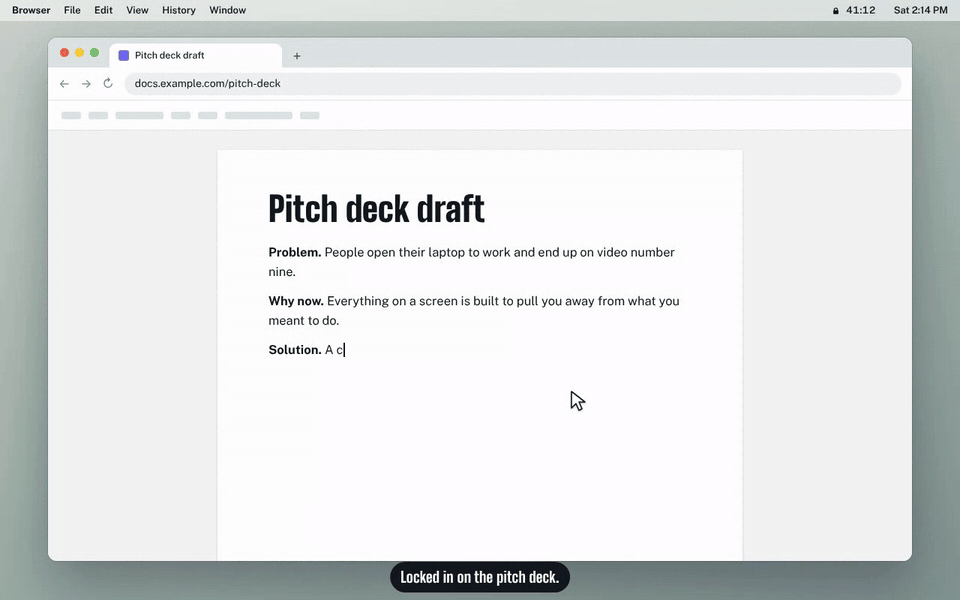

# Lock In

**You drift. It notices. It drags you back.**



A desktop focus coach for macOS with a mouth on it. A one-minute setup asks what you're going after, what's on today and what distracts you, it watches which app and site you are in, and when you drift it nudges, then talks, then yells you back to work ("why are you so locked out again?"), and reopens exactly what you were doing. It also reads your to-do list and roasts you when you've been on the computer for hours without finishing anything, runs your daily routines, and can reach you on every surface from a corner card to your phone.

## Download

**[Download Lock In for Mac](https://github.com/gracezrx/lock-in/releases/latest/download/Lock-In-mac-arm64.zip)** (Apple silicon: M1 or later, macOS 13+), or see [all releases](https://github.com/gracezrx/lock-in/releases).

1. Open the zip and drag **Lock In** into Applications.
2. Open it. Lock In isn't signed with an Apple Developer ID yet, so the first time macOS says it can't check it for malware. Click **Done**, then open *System Settings → Privacy & Security*, scroll down and click **Open Anyway** next to Lock In. (Or run `xattr -cr "/Applications/Lock In.app"` once in Terminal.)
3. Look for the padlock in your menu bar. Setup takes a minute.

## Build from source

You need macOS 13 or later, Node.js 20 or later, and a Chrome-family browser (Chrome, Arc, Brave or Edge).

```bash
xcode-select --install   # once, if you don't have the Command Line Tools (needed for the window sensor)
cd lock-in
npm install
npm run dev              # builds the Swift sensor + the app, then launches it
```

`npm run package:mac` builds the downloadable app (`release/Lock-In-mac-arm64.zip`). The Chrome extension is separate: `npm run extension:zip` builds `release/Lock-In-Extended.zip`. Pushing a new `version` in `package.json` to `main` builds both on GitHub and publishes them as one release.

### Install your build as a normal app

Run `bash scripts/install-mac.sh` after `npm run build`. It makes **Lock In** in your Applications folder: Spotlight and Launchpad find it, and its padlock sits in the menu bar. Run it again to update; the app itself does not change between updates (the code lives in `~/Library/Application Support/Lock In/runtime`), so macOS keeps the permissions you gave it. *Settings → Open when I log in* keeps it in the menu bar after restarts.

Then, inside the app:

1. **Set it up.** Setup opens on first launch: five questions, then the connections.
   - **What you're going after**: one to three big goals ("Fundraise well", "Launch my side projects"), each with an optional date, plus daily habits Lock In measures for you (focus hours, breaks, water, start time, bedtime).
   - **Today's to-dos**: Lock In's own list by default (write today's right there, with a "step toward" each goal one tap away), or connect Reminders, Things, Todoist or a spreadsheet.
   - **What pulls you off track**: the sites (YouTube, X, Reddit…) and the apps on this Mac. Games, streaming and social apps are picked for you; chat apps are offered but start off. Optionally, what you do, which decides what counts as work.
   - **Who's going to yell at you?**: the coach's personality (sassy best friend, gentle friend, firm coach, drill sergeant), with a sample line each, and *Hear your coach*. Then the two keys, each with *Get a key* (it opens the right page), what it does, and the permissions to tick: Claude for live lines, ElevenLabs for the voice and talking back. Both optional. It also points to making a coach from someone's voice (your mom, your boss) on the Coach page.
   - **Help make Lock In better?**: whether to share anonymous usage data (see [Usage data](#usage-data)). Which features you use is on unless you turn it off; app usage has no default, you pick *Share it* or *Keep it*.
   - **Hook it up**: the last screen walks through the connections, a click or two each, and ticks them off as they work: the padlock in the menu bar (*Show me*, and *Open when I log in*), Accessibility (*Allow*), the microphone (*Allow*, for talking back), Lock In Extended (*Get it* opens the download and your browser's extensions page, with the three steps to add it), and your calendar (*Connect* reads the calendars already on your Mac; if your Google account isn't there yet, *Add Google account* opens Internet Accounts and Lock In picks it up by itself). Anything skipped is in *Settings*.
   - Everything else (work apps and sites, the coach's style, check-ins) starts from sensible defaults and lives in Settings and on the Coach page.
2. **Follow *Settings → Permissions*:**
   - Allow **Accessibility**. While running from source, macOS lists the app as **Electron**; turn it on there.
   - Add the browser extension: download `Lock-In-Extended.zip` from the [releases page](https://github.com/gracezrx/lock-in/releases/latest) (or build it with `npm run build:extension`, into `dist/extension`). Open `chrome://extensions`, turn on **Developer mode**, click **Load unpacked**, and pick the unzipped folder. (It's [Lock In Extended](#lock-in-extended-the-chrome-extension), which also works without the Mac app.)
   - Allow the **microphone** if you want to answer the coach out loud.
3. **Add keys (optional)** in *Settings → Keys*:
   - A [Claude API key](https://console.anthropic.com/) gives live, specific coach lines, spoken back-and-forth, and labeling of sites it hasn't seen.
   - An [ElevenLabs API key](https://elevenlabs.io/) gives the coach a real voice (the drill sergeant actually shouts) and lets it hear your replies.
   - Without keys, the coach uses pre-written lines and the built-in Mac voice, and you answer with buttons or by typing.
4. **Change your to-do list** any time on the *To-dos* page: Apple Reminders, Things 3, Todoist, a spreadsheet (Google Sheets, Excel, Numbers or CSV), or Lock In's own list. Reminders and Things ask macOS for permission the first time (System Settings, Privacy and Security, Automation). Todoist needs your API token from Todoist's Settings, Integrations, Developer.
5. **Try it:** *Coach → Try the coach* shows every level with a pretend YouTube drift. *To-dos → Roasts → Try it* shows the roasts. *Settings → Routines → Try it* fires any routine. Then lock in for real from the first tab.

Keep Lock In running (it lives in the menu bar) so the to-do watchdog, deadline reminders and routines work all day.

## The menu bar panel

Lock In lives in the menu bar. Click the padlock and a small panel drops down under it:

- **Lock in on…**: type what you're working on (or keep the last one), pick 25, 50 or 90 minutes, press *Lock in* (or Enter).
- **While you're locked in**: the countdown, whether you're locked in or drifting, minutes focused and drifting, *Mute 30 min* and *End session* (with Commitment mode, you type a sentence first).
- **Due today or overdue** deadlines at the top, with *Lock in* and *Done*.
- **Today** in three numbers: minutes focused, to-dos done, and your streak.
- **Up next**: your top to-dos. Tick one off, press ▶ to lock in on it, or **+** to add one.
- **Goals** at a glance (with *+1 💧* for water) and your **crew**, with *Bomb* for whoever is drifting.
- **Talk to Lock In** at the bottom, and ⚙ for Settings.

Esc or a click anywhere else closes it; ⌘⇧L opens it from the keyboard. Right-click the padlock for *Settings*, *Open at login* and *Quit*. There's no Dock icon and no big window: the window opens only for **Settings** (and the setup pages under it: to-dos, goals, friends, coach), and its Dock icon goes away again when you close it. Prefer the full app? *Settings → Where Lock In lives → Classic window* brings back the window with every page and the plain menu.

## The look

Lock In looks like a cell block at night, but reading comes first: text always sits on a solid, high-contrast background in plain letters (stencil is kept for the big timer and numbers), and the cinderblock wall with its searchlight only shows in the empty space beside the page on wide windows. Your cursor is a small key. Things you can click light up when the key is over them, and the key turns when you click. Every page in the sidebar has a padlock, and going to a page unlocks it while a cell door slides away. On the To-dos page each to-do is a padlock: unlock it to mark it done, and it's scratched on the wall as a tally mark. Prefer the plain version? *Settings → How Lock In looks* switches to Classic, or turns off just the key cursor.

## The pages

These are the window's pages (with the menu bar panel, *Lock in* and *Progress* are the panel itself, and the window shows the rest). Each page has one job:

- **Lock in** (start now): what you're locking in on, what's up next (your top to-do, a deadline due today with *Lock in on it* and *Done*, your next meeting), today's goals and your crew. While something isn't set up yet, a short *Finish setting up* list sits underneath.
- **To-dos** (what to do): every open to-do, *Done today*, a **one-week calendar** (meetings, deadlines and to-dos due each day), your **deadlines**, then *Your list*: where your to-dos come from, and roasts.
- **Goals** (where you're going, beta): what you're going after ("Fundraise well"), kept in view every day, and daily habits Lock In measures for you. See below.
- **Progress** (how it's going): focus minutes today, your sessions, what pulled you away this week, what gets you back, your week in numbers, and streaks and achievements.
- **Friends**: your crew, statuses and Lock In bombs.
- **Coach** (who talks to you and how): personality, a coach made from someone you know, voice, tolerance, talking out loud, and the coach's limits.
- **Settings** (everything else, with links to jump to each part): your work profile (*Edit profile*, then *Finish editing*), permissions, keys, notifications and how Lock In reaches out, routines, calendar, your phone, the look, Goals on or off, the daily export, your data and the activity log.

## Deadlines

Add one on the *To-dos* page, under *Deadlines* (what, the date, and a time if it has one), or press 📌 next to a to-do that has a due date. Until it's done Lock In reminds you **once 3 days before** (10 am), **twice 2 days before** (10 am, 3 pm) and **three times the day before** (10 am, 2 pm, 6 pm), each one sharper than the last. Reminders you miss because the Mac was asleep catch up, spaced 45 minutes apart; none come during a session, a call or a meeting. On the day it's pinned at the top of *Lock in* and in the menu bar. Ticking it adds it to *Done today* and the export; a deadline made from a to-do is done when that to-do is.

You can also set keys with environment variables: `ANTHROPIC_API_KEY`, `ELEVENLABS_API_KEY` and `TODOIST_API_TOKEN`.

## How the coach escalates

Drift builds while you are on distracting sites or apps (after 60 seconds of grace) and drains twice as fast while you work. With the default 5-minute tolerance:

| Drift | Level | What happens |
| --- | --- | --- |
| 2 min | 1, nudge | A chime and a corner card: *Back to it* or *Take a break* |
| 5 min | 2, coach speaks | A spoken line naming the site and your goal; the mic opens for an answer |
| 7.5 min | 3, yellow card | Video paused, a full-screen card, a live call-out that repeats every 30 seconds |
| 10 min (or a third yellow card) | 4, red card | The site is blocked for the rest of the session; desktop apps are hidden |

Every level offers the same ways back: **Back to it** (closes the distraction and reopens your last file or tab), **a 5-minute starter task**, **a real break**, **this is work** (teaches the classifier), **talk it out**, or **end session**. Two straight minutes of real work also resets the ladder.

The coach stays silent during calls (mic in use, or Zoom, Meet or Teams in front), in quiet hours, after 6 spoken interventions in an hour, and for 30 minutes after you press **⌘⇧M**. If you say you are overwhelmed or unwell, it drops the persona and offers a break.

## Personalities

**Sassy best friend** is the default: dry, dramatic, a little mean about your habits, secretly on your side. ("Babe. YouTube? For twelve minutes? We said the deck.") Also available: gentle friend, firm coach, drill sergeant. Change it in *Coach*. Every persona roasts the habit, never the person, and drops the act if you say you're overwhelmed or unwell.

## A coach that talks like someone you know

Your mum, your boss, your old swim coach: under *Coach → Personality → Or someone you know*, give Lock In recordings and messages of them, and it distills how they talk into everything the coach says.

1. **Feed it.** Drop in voice memos, calls, meeting recordings or videos (.m4a, .mp3, .wav, .mp4, .mov…) and chats or emails saved as text, or paste messages straight in. Add a few notes too ("calls me 宝贝, always asks if I ate").
2. **Say which voice is them.** ElevenLabs turns each recording into words and tells the voices apart. If more than one person talks, Lock In shows a few lines from each voice and you pick theirs. Only their words are used.
3. **Distill.** Claude reads everything they said and writes their version of every moment: the four drift levels, your answers, breaks, to-do roasts and wins, every routine, and how a conversation starts. It also learns what they call you, their sayings and the languages they mix. At about 800 of their words it distills by itself (a 10-minute call is about 1,000); you can distill earlier for a rough sketch, and again whenever you add more.
4. **Tweak.** Every line is editable, with {placeholders} like {site}, {goal} and {top} filled in when it's said. Lines you rewrite stay yours when you distill again. No Claude key? Write the lines and a description yourself.
5. **Their voice (optional).** With a minute or two of them talking on their own, and their yes, ElevenLabs can make a copy of their voice on your account (needs a paid ElevenLabs plan and a key with *Voices: Write*). Lock In cuts their voice out of your recordings for it. Then spoken lines and live conversations use it, in their language.

Press *Make … my coach*. They push as hard as the built-in personality you pick for them (gentle, firm, sassy or drill sergeant), and any moment without a line of theirs uses that personality's. If you're not okay, the coach is still them, at their kindest. Recordings stay in Lock In's data folder; they only go to ElevenLabs to be turned into words, and their words only to Claude, both with your keys. Only use recordings you're allowed to use.

## To-do roasts

Lock In counts the minutes you are actually at the computer (keyboard or mouse in the last minute), all day. If you have open to-dos and finish nothing for 90 active minutes (adjustable), you get roasted. The next roast comes after 45 more minutes and hits harder; the one after that, 30 minutes later, is a full-screen intervention with a phone push. Finishing any task resets the clock and gets you a (suspicious) celebration.

No roasts during a focus session, a call, a mute, or the 10 minutes after a session. At most 6 a day. *Leave me alone for 30* snoozes them.

## Spreadsheet to-do lists

Pick *Spreadsheet* on the To-dos page, then paste a Google Sheets link or choose an Excel, Numbers or CSV file. Lock In finds the task, done, due-date, priority and assigned-to columns on its own (checkboxes, TRUE/FALSE, "Done", "Completed", "x" and ✓ all count as done) and shows what it found. Any column can be changed by hand.

It reads real-world trackers, not just tidy lists:

- **The right tab.** Pick one from the list, or leave it to Lock In: it picks the tab named after you, else the tab the sheet says to edit ("please edit under the All Tasks tab"), else the one with the most tasks.
- **The table, not the furniture.** It finds the row of column names wherever it is and ignores titles, totals, filters and dashboards above it. Rows like "TOTAL TASKS", "Filter Week:", "35", "WEEK 2" or instructions are left out, and so are cancelled rows. The setup screen shows what was left out.
- **Your rows only.** In a shared sheet with an Assignee/Owner column, it keeps the rows assigned to you (matched to your Mac account name); switch to *Everyone* or anyone else in *Whose tasks count*.
- **Not a task?** Point at a row on the To-dos page and click *Not a task* to hide it for good.

- **Google Sheets, shared link:** share the sheet as "Anyone with the link can view". Lock In reads it every two minutes. Tick tasks off in the sheet.
- **Google Sheets, private:** use the private connector. Lock In gives you a short Apps Script to paste into the sheet (Extensions, Apps Script), which you deploy as a web app. The sheet stays private, and you can tick tasks off and add new ones from Lock In.
- **Excel or CSV file:** read from your Mac whenever the file changes. Tick tasks off in the file.
- **Numbers file:** read through the Numbers app every 10 minutes. You can tick tasks off from Lock In.

A row counts as done today when Lock In saw it open earlier and it is now ticked. If your sheet has no done column, deleting a row counts as finishing it.

## Routines

| Routine | When | What it does |
| --- | --- | --- |
| Morning kickoff | 9:00 weekdays | Reads your to-dos and offers to lock in on the top one |
| Deep work block | Off until you set a time in *Settings → Routines* | Offers a session on your top task |
| Drink water | Every 60 min of screen time | |
| Stand up and stretch | Every 50 min of screen time | |
| 20-20-20 eye break | Off by default | Every 20 min of screen time |
| Lunch | 12:30 | |
| Midday reality check | 2:00 pm weekdays | Done vs left, with commentary |
| End-of-day shutdown | 6:00 pm weekdays | What you finished, then "End my day" mutes the coach until morning |
| Bedtime | 11:30 pm | Nags every 15 minutes while you stay on, turning into a red card |
| Weekly review | Sunday 5:00 pm | Focus hours and tasks done this week |

Times, days and intervals are editable, and you can add your own (with an optional "Lock in" button). Timed routines fire once a day if you are at the computer within 90 minutes of their time. Repeating ones count only active minutes and wait until a focus session ends. A real break (five minutes or more away) starts the stretch and eye-break counts over, so they never greet you as you sit back down. Water, stretching, eye breaks, lunch, the kickoff, the midday check and the weekly review wait for a natural pause (see *How Lock In reaches out*). With a break goal, the stretch reminder steps aside for it. **Pomodoro**: pick *4×25* on the home screen for four 25-minute rounds with 5-minute breaks.

## Lock In Extended: the Chrome extension

Lock In in your Chrome toolbar. Click the padlock and the control panel drops down: lock in on something for 25, 50 or 90 minutes, watch the clock and the drift meter, take five, mute, end. Mark the site you're on as work or a distraction, tick off to-dos, count down goals, see your crew and bomb whoever is on Reddit. Settings has your coach (all four personalities), how patient it is, its voice (Chrome's voices), your distraction list, a private calendar link for quiet in meetings, and the link to the Mac app.

It works two ways, and switches by itself:

- **On its own** (no Mac app, or not a Mac): the same engine as the Mac app runs on Chrome's tabs. The same drift ladder: a corner card, then it talks, then a card covers the page until you choose, then the site is blocked until the session ends. Crews work too (the same relay and encryption as the Mac app, so Chrome and Mac friends share a crew).
- **Linked to Lock In for Mac**: the moment the Mac app is open, the extension links up over `127.0.0.1` and becomes the same you: your profile and coach, site labels, crew (as the same member, not a second one), to-dos, goals and today's meetings. The Mac does the coaching (it sees every app, not just Chrome) and the panel drives it. A session running in Chrome moves to the Mac; sessions you ran in Chrome alone go into your Mac history, and to-dos you added there go onto your Mac's list. Quit the Mac app mid-session and Chrome picks the session up where it was.

It ships separately from the Mac app: download `Lock-In-Extended.zip` from the [releases page](https://github.com/gracezrx/lock-in/releases/latest), or build it with `npm run build:extension` (it lands in `dist/extension`), or `npm run extension:zip` for the release and Chrome Web Store upload (`release/Lock-In-Extended.zip`).

## Lock in with friends

The **Friends** tab. Start a crew and send friends the invite code (each of them needs Lock In on their Mac), or paste a code to join.

- **See each other**: who's locked in (and on what, if they share it), who's drifting (and where, if they share it), who's free, in a meeting, away or offline.
- **Lock In bombs**: everyone gets **3 a day**. A bomb only lands on a friend who is at their computer and *not* locked in. Pick an insult (or write your own) and **every distraction on their Mac locks for 5 minutes**: distracting sites turn into a "Lock In bomb from you" page with a countdown (open tabs too), and distracting apps are hidden the moment they're opened. Then their screen goes red for **5 seconds**, no dismissing, while their coach reads it out, and they can lock in, bomb you back, or say "okay, okay". In a meeting, on a call, on mute, in quiet hours, or with *Bombs take over my screen* off, the red card is a corner card instead (the 5-minute lock still holds; *Bombs lock my distractions* turns that off). The menu bar shows 💣 and the time left; a second bomb adds to it. If they locked in before it arrived, it bounces and you get it back.
- **Most roasted this week**: bombs that landed, yellow and red cards and to-do roasts since Monday. You don't want to top it.
- **Crew feed**: bombs, lock-ins and achievements as they happen.

How it travels: there's no Lock In server. A crew shares one topic on [ntfy](https://ntfy.sh) (ntfy.sh by default; any ntfy server works, set it under *Crew settings*), and every message is encrypted (AES-256-GCM) with a key derived from the invite code, so the relay only sees an unguessable topic and ciphertext. The rules are kept by the person they protect: your app counts the bombs each friend has landed on you today and ignores a fourth, and ignores bombs that arrive more than 2 minutes late.

## Streaks and achievements

A day counts toward your **streak** with 25 focused minutes. **Achievements** come from what Lock In already sees: *First lock*, *Relapse survivor* (survived 3 YouTube relapses before lunch), *Clean sheet*, *Iron butt* (90 minutes, zero drifts), *Early bird*, *Night owl*, *Deep diver*, *Three-peat*, *Week of steel*, *To-do terminator*, *Comeback kid*, *Bomb squad*, *Took the hit*, *Return to sender* and *Roast magnet*. They're on the Progress page; new ones pop up as you earn them and show in your crew's feed.

## Picking a voice

*Coach → Voice* has a few natural ElevenLabs voices picked for a coach (Jessica, Sarah, Laura, Lily, River, Will, Chris, Charlie, Adam), every voice on your own ElevenLabs account (clones, designed voices, ones you saved), and a search of the public ElevenLabs Voice Library (natural conversational voices first; filter by voice and accent or search for anything). *Preview* plays your coach saying one of its lines in that voice (a few ElevenLabs credits, then cached); *Use* switches the coach, and live conversations switch too. Using a Voice Library voice adds it to your ElevenLabs voices, which needs **Voices: Write** on the key; with a read-only key, press *Add to my voices* on elevenlabs.io instead and it shows up under *Your ElevenLabs voices*. A voice ID can still be pasted under *Advanced*.

## Talking with Lock In

**Hold the space bar** for half a second anywhere, or press **⌘⇧Space** (or *Talk to Lock In* in the menu bar, or *Talk to me* on the first tab), and just talk; hold space again to hang up. A quick tap of space still types a space (it lands when you let go, or right away if you keep typing), and space with ⌘, ⌃, ⌥, ⇧ or Fn is left alone. Holding space is left alone in apps and sites where it already does something (Figma, Photoshop, Sketch, Miro, Excalidraw and other canvases, Logic and GarageBand, Zoom, Meet, Teams and Discord, any call) and in Lock In itself; turn it off under *Coach → Hold space to talk*. A small Swift watcher (`native/mac-helper/keys.swift`) does this; it only looks at the space bar and uses the Accessibility permission Lock In already has. With an ElevenLabs key it's a live voice conversation: natural turn-taking, you can interrupt, and a small panel at the top right shows what was said. Without one, you type.

Tell it what you did ("I was doing the pitch deck and sent Sam the invoice") and it ticks matching tasks off your list and adds the rest to *Done today*; either way the roast clock resets. It can also start a session ("lock me in on the deck for an hour"), give you space, relabel a site as work, or add a to-do. After a to-do roast the mic opens on its own so you can answer back (*Coach → Answer roasts out loud*); it hangs up after 35 seconds of silence and every conversation has a time limit.

How it works: the first time, Lock In creates a voice agent called "Lock In coach" on your ElevenLabs account, with Lock In's prompt and actions (and your voice). Each conversation gets a one-time link from the main process, so the key never reaches the page. Conversations are billed to your ElevenLabs credits by the minute. The key needs **Text to Speech**, **Speech to Text** and **ElevenAgents: Write**.

## Goals (beta)

### What you're going after

Big goals are the point: "Fundraise well", "Launch cool side products", usually with an end date (this month, this quarter, the end of the year, or a date you pick) and a reason. Lock In keeps them in view:

- **It notices what you already do for them.** To-dos you finish, what you lock in on, and your meetings count toward a goal when they mention something on its list ("investors", "pitch deck", "Sequoia"). The list starts from the goal's own words plus the usual ones for goals like it (a fundraising goal starts with investors, VC, pitch, deck, term sheet, data room, angel). With a Claude key, the coach writes the list from your goal, your reason and what you've been working on. Edit it any time.
- **Each goal shows** days left, the last 7 days it moved forward, what moved it ("Fri · Done: Pitch deck v3"), and the next to-do on your list that counts toward it, with *Lock in on it*. *I moved it forward today* covers anything Lock In can't see.
- **A check-in once a day, only when it's needed.** If nothing has happened on a goal by late morning, a card comes at a natural pause: "Fundraise well. 65 days left. Nothing on it yet today. Next on your list: “Reply to investors”", with *Lock in on it*, *Already did something* and *Not today*. A goal you've already moved forward today gets no card. With several goals, the one you've gone longest without moving goes first.
- **It asks about things you keep coming back to.** When a name or project shows up on two or more days in a week and isn't on any list, Lock In asks: "Is “Lock In” part of “Launch cool side products”?" Yes puts it on that goal's list, so it counts from then on. No means it won't ask again. Lock In guesses the likely goal from the words around it ("Ship Lock In 1.2" sounds like a product, "Sequoia pitch" like fundraising). With a Claude key, the coach makes that guess once a day and phrases the question ("Is Lock In one of your cool side products?"). At most one question card a day, and all of them are on the Goals page under *Lock In is asking*.
- **Starting a session says what it's for:** "Locked in. Pitch deck review, 50 minutes. Counts toward “Fundraise well”."
- **The coach knows them:** days left, how many of the last days you moved each one forward, the next step, and the latest thing that counted, so it can bring them up when you talk.

### Daily habits

Smaller, measurable goals Lock In tracks for you from what it already sees:

| Goal | Measured from |
| --- | --- |
| Focus *N* hours a day (or on weekdays) | your focus sessions |
| A break at least every *N* minutes | five minutes or more away from the computer counts as a break |
| Drink water *N* times a day | glasses you log from the water reminder, the menu bar or your phone |
| Off the computer by a time | your last activity of the night (past midnight counts as the same night) |
| Start focusing by a time | your first focus session |
| Drift under *N* minutes a day | drifting during sessions |
| Finish *N* to-dos a day | your to-do list and what you tell Lock In |

Each habit shows today's progress, why it matters (if you add a reason), and the last seven days.

**Lock In noticed.** From your last week or two, Lock In compares you with your own normal and suggests a goal when something stands out: long stretches without a break, long days with no water logged, late nights or 10-hour days, little focused time on weekdays (meetings don't count against you), a lot of drifting, a to-do list that isn't moving, or starting late. Each suggestion shows the numbers behind it and a modest target (a step from your usual, never a leap). When you're overdoing it, it suggests a stop time first and never "focus more". *Make it a goal*, change the target, *Not now* (a week) or *Don't suggest this*. It also keeps your goals the right size: after a week unchanged, a goal you hit on nearly every day gets a small step up, and one that's out of reach on most days gets a step you can actually hit (never more than an hour of focus at once). At most one "Lock In noticed something" card a day, at a natural pause. With a Claude key, *Ask the coach for ideas* sends the same day-by-day numbers (no apps, sites or titles) for up to three more.

**Nudges.** A break card when a stretch reaches your break goal (not during a session, and dropped if you take a break first). For focus, Lock In looks ahead instead of checking at a fixed time: at a natural pause, if you're 30 minutes or more behind an even pace through your day (measured from when you started, to your stop time or your usual end) and your calendar has room right now, it offers a session that fits the room. After a meeting, the "Meeting over" card says how far behind you are. A nudge when it's past your start time with no session yet, and a heads-up 15 minutes before your stop time. Turn suggestions, nudges or the whole beta off on the Goals page (turn it back on in *Settings*).

Suggestions start after about three days at the computer: breaks, water and bedtimes need the rhythm Lock In records from the day you update.

## How Lock In reaches out

Being proactive isn't the same as interrupting more. What the research on proactive assistants and just-in-time nudges agrees on, and what Lock In does about it:

- **Timing matters as much as content.** An interruption costs least at a natural pause, and most in the middle of a task. Reminders that can wait (water, stretching, eye breaks, lunch, the kickoff, the midday check, the weekly review, goal nudges, "Lock In noticed something") wait for one: when you're back from a break, a session or a meeting has just ended, or you've just finished a to-do. They show up 20 seconds to 3 minutes after the pause, once you've settled. Idle time isn't treated as a pause, because often you're thinking.
- **The wait is bounded.** If no pause comes, a reminder goes out anyway after a while (water after 30 minutes), or is dropped once it no longer applies (an eye break after 10).
- **Saying nothing is an answer too.** A natural break makes "stand up and stretch" pointless, so it's dropped, and one "get up" card covers the others. Nothing goes out during a session, a call, a meeting or while you're away.
- **One budget for everything.** At most 12 of these a day and 20 minutes of quiet after any card, a roast or a meeting heads-up included. Both are adjustable in *Settings → How Lock In reaches out*.
- **It learns which cards you ignore.** Let two of a kind go by in a row and Lock In skips every other one; four in a row and it skips two of every three. Acting on one brings that kind back to normal. *Settings → How Lock In reaches out* shows what it has learned, with *Back to normal*.

Meetings, deadlines, to-do roasts, bedtime and anything you snoozed come when they need to: they skip the gate, but still count toward the quiet time between cards. All of this runs inside the existing one-second loop, with no extra dependencies and no extra calls to Claude.

## Lock In on your phone

Turn it on in *Settings → Your phone*. Your Mac then answers your phone over the same Wi-Fi:

1. Scan the QR code with your phone's camera (it opens `http://<your-mac>.local:47620`).
2. On an iPhone, tap Share → **Add to Home Screen**, and open Lock In from your Home Screen. It opens like an app, full screen.
3. Press **Pair a phone** on your Mac and type the 6-digit code on your phone.

From your phone you can start and end sessions (with a live countdown), see today's goals and log a glass of water, pause the coach, tick off and add to-dos, see your crew and throw Lock In bombs, talk to the coach (type, or tap the mic on your keyboard; it answers out loud in its voice), and send voice memos, videos and messages to a coach made from someone you know.

The layout is made for phones first and also fits tablets. Your Mac does all the work, so it has to be awake with Lock In open. Everything between the phone and the Mac is encrypted with a key only those two share (made when you pair; the code never crosses the network). Removing a phone in *Settings* locks it out. Campus and office Wi-Fi often stop devices from seeing each other; then use it at home, or join your phone's hotspot from your Mac.

## Calendar

*Settings → Calendar → Connect your Google account* reads the Calendar app on your Mac: add your Google account once under *System Settings → Internet Accounts* (Brown, school and work accounts too, which often hide their iCal links), press *Connect*, and allow Full Access when macOS asks. iCloud and Outlook/Exchange calendars in the Calendar app come along; untick any calendar Lock In should ignore (birthdays and holidays start unticked). It is read every 2 minutes, on the Mac, read-only. A small Swift reader (`native/mac-helper/calendar.swift`) does this; `npm run helper` builds it (the download comes with it).

It also takes private iCal links (Google: *Settings → your calendar → Integrate calendar → Secret address in iCal format*; Outlook: *Publish a calendar*; iCloud: *Public Calendar*). Lock In reads them every 10 minutes (read-only) and then:

- stays quiet during meetings (no roasts or check-ins),
- shows a heads-up with the call link a few minutes before each one,
- when a meeting ends with a real gap, offers a session sized to it,
- ends sessions before your next meeting,
- tells the coach what your day looks like.

Repeating events, moved or skipped occurrences, cancelled and declined events, all-day and "free" events and time zones are handled.

## Your data: kept, exported, portable

Everything stays on this Mac. Lock In keeps a copy you can open and take anywhere in **Documents → Lock In** (*Settings → Your data* to change or open it), refreshed every hour:

| File | What's in it |
| --- | --- |
| `Lock In - to-dos by day.csv` | every to-do on your list each day, open or done: task, status, due, overdue, project, list, when you finished it and how |
| `Lock In - done log.csv` | everything you ever finished |
| `Lock In - deadlines.csv` | every deadline, done or not |
| `Lock In - daily summary.csv`, `Lock In - sessions.csv` | focus, drift, meetings and sessions |
| `Days/2026-10-25.csv` | one day in order, ending with what was still open |
| `Backups/Lock In backup 2026-10-25.zip` | a full backup every day (the last 14 are kept) |

Lock In also records the day's to-do list itself (in `todo-days/`, one file per day), so the history stays even if your to-do app forgets finished items. **Moving to a new Mac**: copy a backup over, install Lock In, and choose *Settings → Your data → Restore from a backup*. Backups hold every record except API keys (they're tied to this Mac's keychain), and they do include your calendar links and crew code, so keep them private.

## Daily export

Every day (and every hour, so today is current) Lock In writes CSV files to *Documents/Lock In* (change it under *To-dos → Today*):

| File | One row per |
| --- | --- |
| `Lock In - done log.csv` | finished task: date, time, task, project, list, how (ticked in your list, ticked in Lock In, told the coach) |
| `Lock In - daily summary.csv` | day: tasks done, focus and drift minutes, sessions, screen time, meetings, top distraction, what got done |
| `Lock In - sessions.csv` | focus session |
| `Days/2026-10-24.csv` | that day's tasks, sessions and meetings, in order |

The files are rebuilt from Lock In's records each time, so they never double up, and they open correctly in Excel even with Chinese task names. A *Project* column in your sheet (or *Category*, *Area*, *Client*) carries through.

## Notifications

*Settings → Notifications* is a grid of every moment (nudge, yellow card, red card, to-do roast, task done, routines, body breaks, bedtime, session start and end) against every channel:

- **Corner card** with buttons, and the **full-screen** yellow or red card
- **Chrome card**: a big Lock In card over the tab for 5 seconds (it pauses the video and the page can't be clicked or typed into until it goes). Only when the tab in front is a distraction, like YouTube; on by default for nudges, the yellow and red cards and to-do roasts. Needs the extension 0.2.0 or later.
- **Voice**, and a **sound** per event (referee whistle, air horn, buzzer, sad trombone, fanfare, chime, ding, or any macOS system sound)
- **macOS** Notification Center banners, a flashing **menu bar**, a bouncing **Dock** icon
- **Phone** push through [ntfy](https://ntfy.sh): install the free app, subscribe to a topic name only you know, and paste it in. Red cards and to-do interventions go there by default.
- **Slack or Discord** webhook for opt-in accountability: only the events you tick are posted.

Calls silence voice, sound and full-screen cards. Quiet hours silence voice and sound. Mute (⌘⇧M) silences everything except bedtime. Phone and webhook are capped at 12 messages an hour each.

## Shortcuts

| Shortcut | Action |
| --- | --- |
| ⌘⇧L | Open the menu bar panel to start or end a session (the window, in Classic) |
| ⌘⇧Space | Talk to Lock In (press again to hang up) |
| ⌘⇧M | Mute the coach for 30 minutes (press again to unmute) |
| 1–6 | Pick an option on a yellow or red card |

## Project layout

```text
src/
  main/
    index.ts            app wiring: 1-second loop, tray, shortcuts, IPC
    sensors/            Swift helper process, lsappinfo/AppleScript fallback, extension bridge, sampler
    engine/             classifier (rules → gray-zone → cache → Claude), drift score + ladder, session stats
    coach/              persona lines, Claude prompts, voice (ElevenLabs + `say`), the orchestrator, the announcer for routines and roasts,
                        and coaches made from someone you know (custom.ts: transcripts, distilling, voice copies; style.ts: the active one)
    todos/              Reminders, Things, Todoist, spreadsheets and built-in lists; the watchdog that decides when to roast; the done log
    talk/               live conversations: the ElevenLabs agent, its prompt and actions, the typed fallback
    calendar.ts         iCal links and the Calendar app → today's meetings (quiet, heads-up, gaps, session caps)
    maccal.ts           the Calendar app on this Mac, through native/mac-helper/calendar.swift
    export.ts           the daily CSV files
    deadlines.ts        deadlines: the 3-2-1 reminder schedule, pinning, overdue
    goals.ts            Goals (beta): your daily rhythm, measuring goals, noticing patterns, focus pace, raising and easing goals, checking the coach's ideas
    attention.ts        how Lock In reaches out: natural pauses, one shared budget, and learning which cards you ignore
    voices.ts           the voice picker: picks, your ElevenLabs voices, the Voice Library
    crew/               Lock in with friends: invite codes and encryption, the ntfy relay, statuses and bombs
    phone/              Lock In on your phone: the Wi-Fi server (pairing, sealed requests, uploads) and talking from the phone
    achievements.ts     streaks, weekly numbers and achievements
    routines.ts         the routine scheduler (timed, repeating, bedtime follow-ups, snooze)
    notify.ts           routes every event to cards, voice, sounds, macOS, menu bar, Dock, phone and webhook
    router.ts           pause, close, block, hide app, reopen last work
    guardrails.ts       calls, quiet hours, mute, rate limit
    store.ts            local JSON/NDJSON storage, keychain-encrypted keys
    windows.ts          menu bar panel, settings window, corner toast, full-screen card, talk panel, hidden voice window
  renderer/             the menu bar panel (panel.ts) and the window's seven pages (vanilla TypeScript, bundled fonts)
  phone/                the phone page your Mac serves over Wi-Fi
  shared/               types and role templates
native/mac-helper/      Swift sensor: front app, window title, open document, mic-in-use
src/extension/          Lock In Extended (Chrome, Manifest V3): the service worker, the toolbar panel, the
                        standalone engine on Chrome's tabs (solo.ts), the link to the Mac app (link.ts), page cards
test/                   engine, coach and bridge tests
```

## Privacy

- Everything is stored on your Mac in `~/Library/Application Support/Lock In`. Your own voice is never stored. Recordings you give a coach made from someone are kept in its folder (`coaches/`) until you remove them; backups keep their transcripts, not the audio.
- Nothing about which apps or sites you use is recorded outside a session (unless you share app usage, below), and Claude is only asked to label things during a session. Outside sessions Lock In only counts active minutes (for to-do roasts and routines) and, for Goals, when you were at the computer and when you stepped away (`rhythm.json`: times and totals only). Which cards you act on or ignore is kept as counts per kind of card (`attention.json`). *Delete all activity* deletes both.
- To-do titles stay on your Mac unless you have a Claude key, in which case the top task's title is included when the coach writes a line. For big goals, the coach also sees each goal's title, reason and list, and (once a day) the names and projects you keep coming back to, with a few of the to-do, session and meeting titles they came from.
- Only a small context (app name, site, page title, your goal) goes to Claude, with emails and numbers stripped. *Keep titles on this Mac* sends the site name only.
- Incognito windows, password managers and banking sites are logged as "private" with no details.
- The extension talks to the app over `127.0.0.1` and the app accepts only browser-extension connections, not web pages. On its own, Lock In Extended keeps everything in Chrome's local storage; see [its privacy policy](docs/extension-privacy.md).
- *Settings → Your data* backs up, restores or deletes everything.

### Usage data

To see which features people use, the installed app sends anonymous usage data to Lock In's Supabase project every few minutes (never from `npm run dev` or the tests). Setup asks, and *Settings → Usage data* turns each part off, shows exactly what's sent next, and deletes what's been sent.

- **Which features you use** (on unless you turn it off): a random install id (no name, email or account), the app and macOS version, how you're set up (personality, which keys are added, extension, calendar and to-do provider on or off), and events: sessions started and ended (length, focus and drift minutes), coach levels, talking back, crews and bombs, setup steps, which page is open, and a count of each button and action. Never your goals, to-dos, calendar, window titles, what you type or what the coach says.
- **Which apps and sites you use** (only if you pick *Share it*): seconds per day in each app, and each site in the browser (the domain only), with how Lock In labeled it (work, neutral, distraction) and whether it was during a session. Never window titles, page addresses or files. Apps you mark sensitive, password managers, banking sites, private windows and incognito tabs are counted only as "(private)". Turning it off deletes what was sent.
- The app's key is Supabase's publishable key: it can only add rows through one function (`ingest`), never read anything back. `LOCKIN_TELEMETRY=off` turns it all off; the schema is in [`docs/supabase.sql`](docs/supabase.sql).

## Development

```bash
npm test            # 225 tests: drift ladder, classifier, coach, extension bridge, to-do watchdog and providers, spreadsheets, routines, deadlines, voices, notifications, talking, calendar, export, crews and bombs, achievements, to-do history and backups
npm run typecheck
LOCKIN_SMOKE=1 npm start   # launches, exercises every window, a session, a typed and a voice conversation (against a stand-in server), the calendar and the export; prints SMOKE OK
npm run demo               # re-records docs/demo.gif and docs/demo.mp4 (needs Playwright's Chromium and ffmpeg)
npm run demo:bomb          # the vertical Lock In bomb clip, docs/bomb-demo.mp4 (try -- --them Maya --pronoun she)
npm run demo:bomb:wide     # the same clip in landscape for X/Twitter, docs/bomb-demo-wide.mp4
npm run demo:launch        # the launch film (about a minute), docs/launch.mp4 (AI voices) and docs/launch-your-voice.mp4
                           # (no narrator); python3 scripts/demo/launch/tts.py re-speaks the lines in film.js
npm run demo:walkthrough   # a screen-recording-style walkthrough to talk over on camera, docs/walkthrough.mp4, and
                           # docs/walkthrough-prompter.mp4 with your lines on top (scripts/demo/walkthrough)
```

The demo is a scripted scene (`scripts/demo/stage.html`) that uses the real opening animation (`src/renderer/intro.ts`) and the real card from the extension, so it stays in step with the app. The opening animation plays once each time Lock In starts; click the logo to see it again.

Packaging: `npm run dist` builds an unsigned `.dmg` with electron-builder. For other people to install it without warnings, sign and notarize it with an Apple Developer ID.

## Known limits

- macOS only for now. Windows needs a Rust or C# version of the sensor.
- Safari and Firefox need their own extension builds; without the extension, Lock In reads the active Chrome or Safari tab through AppleScript (macOS asks permission once per browser).
- The full-screen card covers the display under your mouse, not every display.
- Reminders and Things are read through AppleScript; very large Reminders lists can take a few seconds to refresh (every 2 minutes). Todoist completions are detected when a task leaves your filter, so a task you reschedule out of "today" is not counted as done.
- ElevenLabs model names are settings. If the shouting model (`eleven_v3`) is slow or unavailable on your plan, the coach falls back to the everyday model automatically.

## Troubleshooting

- **"Window sensor off"**: run `npm run helper` and check *Settings → Activity log*. Accessibility must be on for **Electron** (dev) or **Lock In** (packaged).
- **"Extension too old"**: download the new `Lock-In-Extended.zip` from the releases page, remove the old one in `chrome://extensions` and add the new folder.
- **Two Lock In extensions in Chrome**: before 1.0 the extension was called "Lock In" and lived inside the app. Remove that one and keep Lock In Extended (from the releases page or `dist/extension`).
- **"Browser not connected"**: make sure the extension is loaded and enabled, then click its toolbar icon and press *Reconnect*. Port 47615 must be free.
- **Talking says "Voice is off"**: the message says why. Usually the ElevenLabs key is missing *ElevenAgents: Write*; edit the key at elevenlabs.io and paste it again. If the mic never opens, allow Lock In under *System Settings → Privacy and Security → Microphone*.
- **No voice**: check the volume cap in *Coach*, quiet hours, and whether you're in a call. *Play a test line* checks the voice on its own.
- **The coach flags real work**: use *Count as work* on the Lock In tab during a session, answer "this is work", or edit *Settings → Edit profile → Sometimes work*.

## License

MIT. See [LICENSE](LICENSE).
